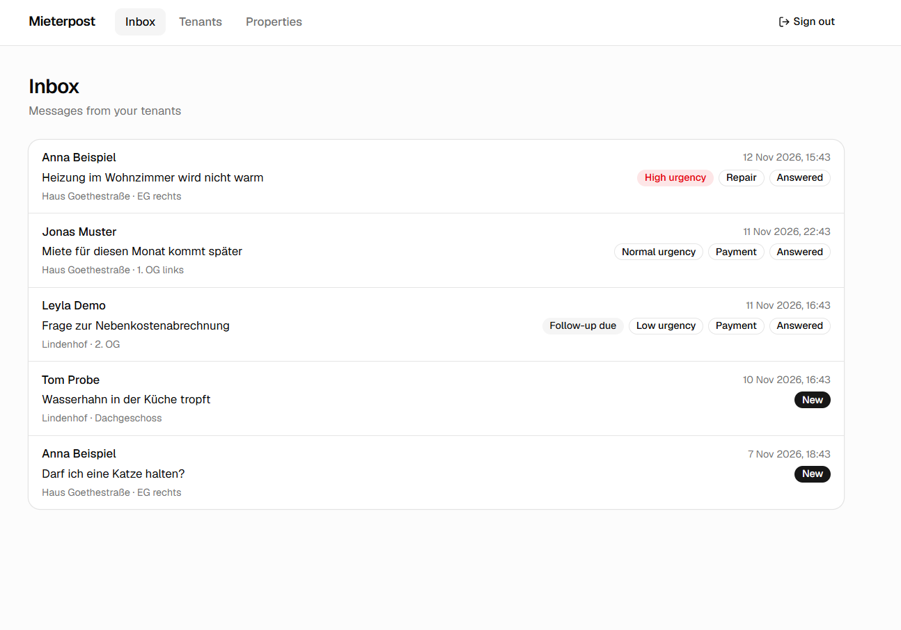
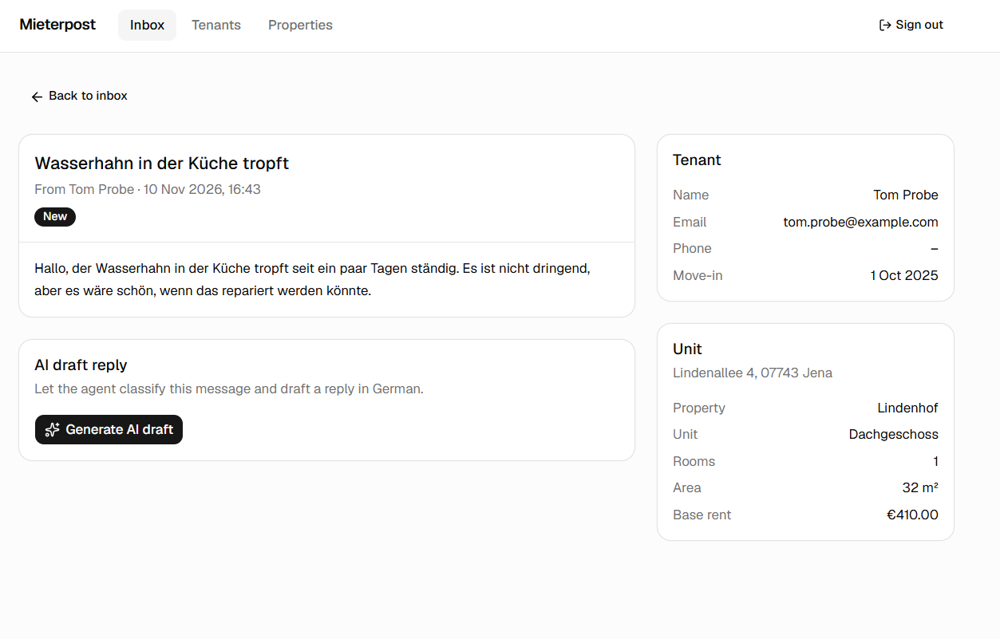
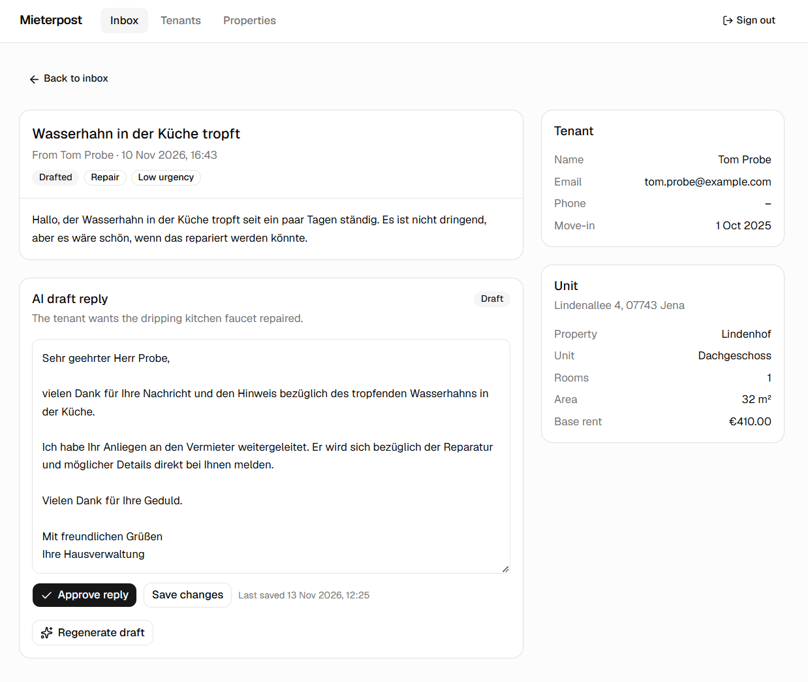
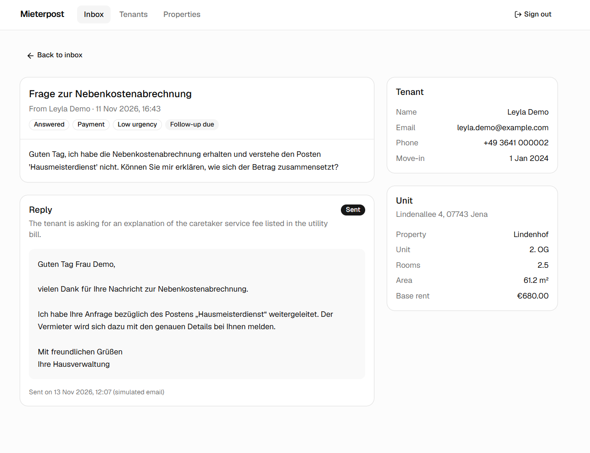
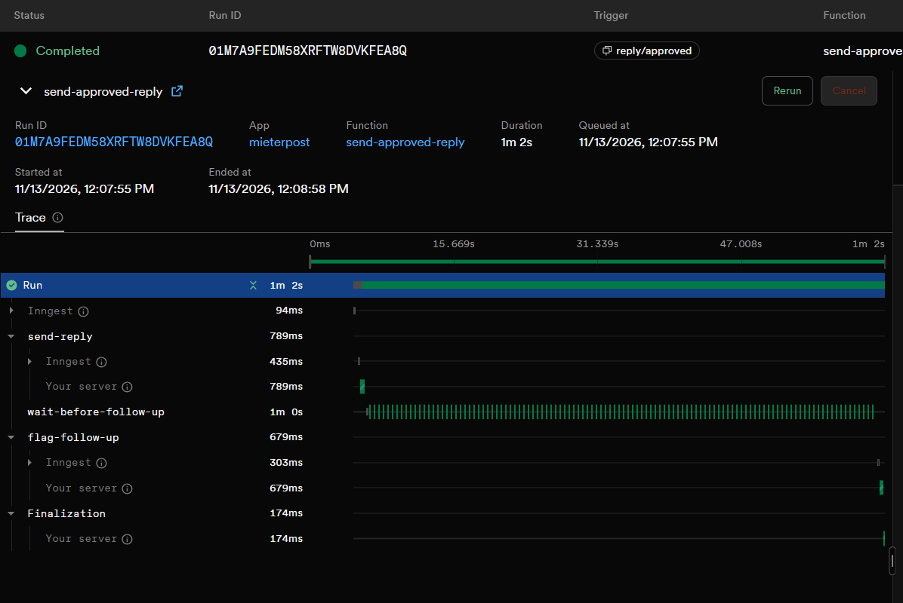
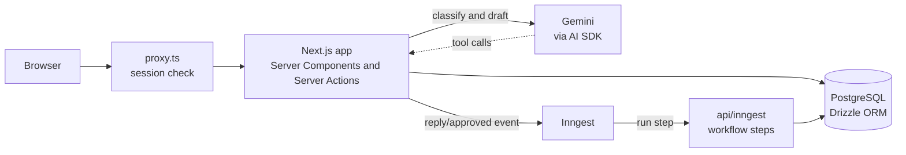

# Mieterpost

An AI inbox assistant for landlords. A tenant writes in, an AI agent classifies
the message and drafts a reply in German, the landlord edits and approves it,
and a background workflow sends it and schedules a follow-up.

**Live demo:** https://mieterpost.vercel.app (password protected; ask me for the demo password)

All tenants, addresses and messages in the demo are fictional.



## How it works

| 1. A new message arrives | 2. The agent classifies it and drafts a reply |
| --- | --- |
|  |  |

| 3. The landlord approves, the reply is sent | 4. A durable workflow does the background work |
| --- | --- |
|  |  |

1. **Classify.** The agent returns structured output (category, urgency, a
   one-sentence summary) that is validated against a schema and saved directly
   to the database.
2. **Draft.** The agent writes a reply in German. It can call two tools to look
   up the tenancy and the tenant's earlier messages.
3. **Review.** The landlord edits the draft, saves it, or approves it. An
   approved reply is locked.
4. **Send and follow up.** Approving emits an event. A durable workflow sends
   the reply, sleeps, and then flags the message for follow-up.

## Architecture



| Part | Local development | Production |
| --- | --- | --- |
| App | `next dev` | Vercel |
| Database | PostgreSQL | Neon |
| Workflow engine | Inngest Dev Server | Inngest Cloud |

## Tech stack

| Area | Choice |
| --- | --- |
| Language | TypeScript |
| Frontend | Next.js 16 (App Router), React 19, Tailwind CSS 4, shadcn/ui |
| Database | PostgreSQL with Drizzle ORM |
| AI | Vercel AI SDK with Gemini 3.5 Flash-Lite (structured output, tool calling) |
| Workflows | Inngest (durable steps, sleep, retries) |
| Auth | Password login, signed HTTP-only session cookie (jose) |
| Validation | Zod |
| Hosting | Vercel, Neon, Inngest Cloud |

## Design decisions

- **The model never touches the database.** It can only request two tools. Both
  are bound to the tenant who wrote the message, so the model cannot read
  another tenant's data, and neither returns email addresses or phone numbers.
- **Prompt injection is treated as expected input.** The system prompts tell the
  agent to treat a tenant's message as content, and never to promise dates,
  money or permission on the landlord's behalf. A human approves every reply.
- **Three layers of access control.** `proxy.ts` redirects visitors without a
  session, every query checks the session again, and every Server Action checks
  it too, because actions are public HTTP endpoints.
- **Writes are transactional.** Marking a message as drafted and saving the
  draft happen together or not at all. Approval takes a row lock so two clicks
  cannot race.
- **The workflow is idempotent.** The event carries a fixed id per message, and
  the send step re-checks the reply status, so a duplicate event cannot send
  twice. Invalid event data fails without retries.
- **Money is stored as integer cents** and only formatted for display.
- **Small model on purpose.** Classification and a short reply are easy tasks.
  A Flash-Lite model keeps cost and latency low.

## Limitations and next steps

- Email sending is simulated (logged, not delivered). Next: a real provider.
- Login is one shared password, enough to protect a demo. Next: user accounts
  with hashed passwords and rate limiting.
- There are no automated tests yet. Next: unit tests for the agent with a mock
  model, and for the workflow with Inngest's test engine.
- Messages are seeded. Next: an inbound email webhook.
- The demo uses a free model tier, so the data must stay fictional. Real tenant
  data would need a paid tier or an EU-hosted model for GDPR reasons.

## Run it locally

Requirements: Node.js 20 or newer, PostgreSQL, a Gemini API key.

1. Install dependencies: `npm install`
2. Create a database: `createdb -U postgres mieterpost`
3. Copy `.env.example` to `.env.local` and fill in the values.
4. Create the tables: `npm run db:push`
5. Add demo data: `npm run db:seed`
6. Start the app: `npm run dev` and open http://localhost:3000
7. In a second terminal, start the workflow engine:
   `npx inngest-cli@latest dev -u http://localhost:3000/api/inngest`

| Variable | Purpose |
| --- | --- |
| `DATABASE_URL` | PostgreSQL connection string |
| `GOOGLE_GENERATIVE_AI_API_KEY` | Gemini API key |
| `APP_PASSWORD` | Password for the sign-in page |
| `SESSION_SECRET` | Signs the session cookie (32+ random characters) |
| `AI_MODEL` | Optional. Defaults to `gemini-3.5-flash-lite` |
| `FOLLOW_UP_DELAY` | Optional. Defaults to `3d`; use `30s` to watch it happen |

In production, `INNGEST_EVENT_KEY` and `INNGEST_SIGNING_KEY` are also required.

## Project structure

```
src/
├─ app/                 pages, Server Actions, the Inngest endpoint
│  ├─ messages/[id]/    message detail, draft editor, actions
│  ├─ login/            sign-in page and actions
│  └─ api/inngest/      endpoint Inngest calls to run workflow steps
├─ ai/                  model config, tools, the agent
├─ inngest/             Inngest client and the durable workflow
├─ db/                  schema, queries (reads), mutations (writes), seed
├─ components/          UI components (ui/ holds shadcn/ui)
├─ lib/                 session handling, formatting helpers
└─ proxy.ts             redirects visitors without a session
```

## Scripts

| Script | What it does |
| --- | --- |
| `npm run dev` | Start the dev server |
| `npm run build` | Production build |
| `npm run typecheck` | Check types without building |
| `npm run lint` | Run ESLint |
| `npm run db:push` | Sync `src/db/schema.ts` to the database |
| `npm run db:seed` | Reset the database to fictional demo data |
| `npm run db:studio` | Browse the database in Drizzle Studio |

## How this was built

I built this project with Claude as an AI pair programmer, working through it
step by step and reviewing each part: the data model, the agent, the workflow,
authentication and deployment.
